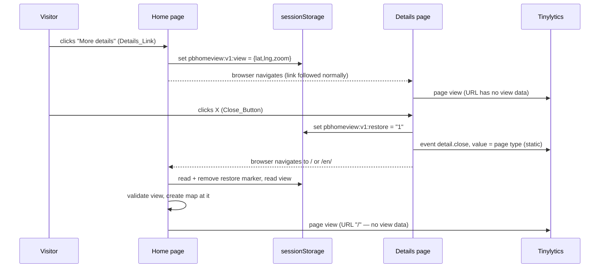

# Design Document

## Overview

Three small pieces, each with one job:

1. **Home page, saving.** A capture-phase listener on the home page document writes the
   Home_View to `sessionStorage` when a Details_Link is clicked.
2. **Details page, closing.** A server-rendered link (the Close_Button) points at the locale's
   home page. Its Tinylytics attributes are fixed at build time. A click listener sets a
   one-time Restore_Marker and otherwise leaves the click alone.
3. **Home page, restoring.** Before the Home_Map is created, the Restore_Marker is consumed. If
   it was set and the View_Record is valid, the map is created at that view.

All storage logic lives in one new module, the View_Store
(`assets/js/home-view-memory.js`). It has no knowledge of Tinylytics, URLs or the DOM beyond
reading link paths and listening for clicks. That keeps the privacy argument short: the only
place the view is written is `sessionStorage`, and the only code that can write it is one
file whose source is guarded by a test.



## Components

### 1. View_Store — `assets/js/home-view-memory.js` (new)

An IIFE exposing `window.PaddelbuchHomeViewMemory`, with the same dual export used by
`spot-popup.js` so Jest can `require()` it.

```js
var STORAGE_PREFIX = 'pbhomeview';
var STORAGE_SCHEMA = 'v1';
var VIEW_KEY    = STORAGE_PREFIX + ':' + STORAGE_SCHEMA + ':view';
var RESTORE_KEY = STORAGE_PREFIX + ':' + STORAGE_SCHEMA + ':restore';
var DETAILS_PATH = /^(\/en)?\/(einstiegsorte|gewaesser|hindernisse|gewaesserereignisse)\/[^\/]+\/?$/;
```

| function | contract |
|---|---|
| `getStorage()` | returns `window.sessionStorage`, or `null` if accessing it throws or it is absent |
| `serialiseView(lat, lng, zoom)` | `{ lat: round5(lat), lng: round5(lng), zoom: zoom }` |
| `saveView(map, storage?)` | reads `map.getCenter()` / `map.getZoom()`, writes `JSON.stringify(serialiseView(...))` to `VIEW_KEY`; swallows every exception; returns `true` on success |
| `limitsFromConfig(config)` | `{ south, west, north, east, minZoom, maxZoom }` from `config.maxBounds`, `config.minZoom`, `config.maxZoom`; `null` if any is missing or non-numeric |
| `isValidView(record, limits)` | Requirement 6.2, exactly; `false` when `limits` is `null` |
| `requestRestore(storage?)` | writes `"1"` to `RESTORE_KEY`; swallows exceptions |
| `consumeRestore(limits, storage?)` | reads `RESTORE_KEY`, **removes it unconditionally**, returns `{ center: [lat, lng], zoom }` only when the marker was `"1"` and `VIEW_KEY` parses to a valid record; otherwise `null`; never throws |
| `isDetailsLink(anchor, origin)` | `anchor.origin === origin && DETAILS_PATH.test(anchor.pathname)` |
| `isUnmodifiedPrimaryClick(event)` | `event.button === 0 && !event.ctrlKey && !event.metaKey && !event.shiftKey && !event.altKey` |
| `wireHomePage(doc, getMap, storage?)` | adds **capture-phase** `click` and `auxclick` listeners on `doc`; finds `event.target.closest('a[href]')`; calls `saveView(getMap(), storage)` when it is a Details_Link |
| `wireDetailsPage(doc, storage?)` | adds a `click` listener to each `.detail-close-btn`; calls `requestRestore(storage)` when `isUnmodifiedPrimaryClick(event)` |

On load the module wires the details page itself: on `DOMContentLoaded` if the document is
still loading, otherwise immediately. On the home page there is no `.detail-close-btn`, so
this is a no-op; the home page is wired explicitly by `home-map.js`, which owns the map.

No listener calls `preventDefault()` or `stopPropagation()`. Every public function catches
its own exceptions, so storage that is blocked, full or tampered with degrades to "no
restore" instead of an error on the page.

### 2. Close_Button include — `_includes/detail-close-btn.html` (new)

```liquid


<span class="h1 detail-close-slot">
  <a href="{{ locale_prefix | append: '/' }}"
     class="detail-close-btn"
     title=""
     aria-label=""
     data-tinylytics-event="detail.close"
     data-tinylytics-event-value="{{ dcb_type }}">
    <svg aria-hidden="true" focusable="false" width="20" height="20" viewBox="0 0 16 16" fill="currentColor">
      <path d="M2.146 2.854a.5.5 0 1 1 .708-.708L8 7.293l5.146-5.147a.5.5 0 0 1 .708.708L8.707 8l5.147 5.146a.5.5 0 0 1-.708.708L8 8.707l-5.146 5.147a.5.5 0 0 1-.708-.708L7.293 8z"/>
    </svg>
  </a>
</span>
<script src="{{ '/assets/js/home-view-memory.js' | relative_url }}"></script>

```

- The include reads `locale_prefix` from the caller instead of including
  `locale-prefix.html` itself. A nested include would need Jekyll's include tag in the
  Liquid render spec. The layout wiring spec (Testing, item 5) checks every caller sets it.
- `fill="currentColor"` is an SVG presentation attribute, not a `style` attribute, so CSP
  `style-src 'self'` does not apply to it.
- The path is the Bootstrap Icons `x-lg` glyph (MIT). Icons are already inlined this way in
  `spot-popup.js`.

### 3. Styles — `_sass/components/_detail-close-btn.scss` (new)

Forwarded from `_sass/components/_components.scss`. Only existing colour variables are used.

```scss
@use "../settings/settings" as *;

.detail-close-btn {
  display: inline-flex;
  align-items: center;
  justify-content: center;
  width: 2.5rem;
  height: 2.5rem;
  border-radius: 50%;
  color: $swisscanoe-blue;
  background-color: transparent;
  text-decoration: none;

  svg {
    pointer-events: none;
  }

  &:hover {
    color: $swisscanoe-blue;
    background-color: $secondary-blue-20;
  }

  &:focus-visible {
    outline: 2px solid $secondary-blue;
    outline-offset: 1px;
  }
}
```

The `:focus-visible` rule matches the one in `_filter-panel.scss`.

On waterway, obstacle and notice pages the X sits at the right of the title row:

```scss
// Title containers holding the X: no right padding, so the X reaches the pane
// edge; the h1 reserves room for the X instead, so its text wraps before it.
.page-waterway-details .waterway-details > .detail-title-row,
.page-obstacle-details .obstacle-description > .obstacle-title,
.page-notice-details .notice-description > .notice-title {
  position: relative;
  padding-right: 0;
  > h1 { padding-right: 3.5rem; overflow-wrap: anywhere; }
}

// Before the h1 and out of flow, so it starts where the first title line starts.
// Bootstrap's .h1 class gives it the title's font size, so 1.2em is one line.
.detail-close-slot {
  position: absolute;
  right: 0;
  display: flex;
  align-items: center;
  box-sizing: content-box;
  height: 1.2em;
  margin: 0;
}

// The waterway h1 carries its own top padding.
.page-waterway-details .detail-close-slot { padding-top: 0.7em; }
```

The title's underline (the waterway h1's own border, or the obstacle/notice title div's)
still spans the full pane width, because only padding, not width, changed.

### 3a. Spot header rows — `_sass/pages/_spot-details.scss` (changed)

Two rows, each with its control at the right:

- **Type row** (`.spot-icon-div`): icon and type label as before, X at the right. The X is
  absolutely positioned (`right: 0`, centred on the 20 px icon), so the icon and label keep
  their exact positions and the row its 40 px height. The row's right padding is `3rem`, so a
  long type label wraps before it reaches the 40 px X.
- **Title row** (`.spot-title`): a flex row. The `<h1>` takes the remaining width
  (`flex: 1 1 auto; min-width: 0; overflow-wrap: anywhere`), so it wraps beside the button,
  even a single long word. The Navigate button is `flex: 0 0 auto`, its float and margins
  removed. `align-items: baseline` puts it beside the title's first line. The row's right
  padding is 0, so the button's right edge lines up with the X's.

Flexbox was rejected for the type row: measured against production, it moved the type label
5 px left (the whitespace between icon and label collapses) and 6.6 px down.

### 4. Layout wiring

| layout | where | call |
|---|---|---|
| `_layouts/spot.html` | inside `.spot-icon-div`, after the type label | `` |
| `_layouts/waterway.html` | inside a new `.detail-title-row` wrapping `h1.waterway-title`, before the h1 | `` |
| `_layouts/obstacle.html` | inside `.obstacle-title`, before the h1 | `` |
| `_layouts/notice.html` | inside `.notice-title`, before the h1 | `` |

`variant="inline"` renders the bare link; `variant="title"` wraps it in the
`.detail-close-slot`. In `spot.html` the Navigate button include moved from the top of the
pane into `.spot-title`, after the `<h1>`.

`spot.html` and `obstacle.html` already `` before the pane.
`waterway.html` and `notice.html` gain that line after their `current_locale` assignment.

### 5. Map creation — `assets/js/paddelbuch-map.js` (changed)

`init(elementId)` becomes `init(elementId, options)`. When `options.initialView` is present,
its `center` and `zoom` replace the config's in `mapOptions` before `L.map()` is called.
Everything else (bounds, min zoom, controls, locate) is unchanged. No details-page caller
passes `options`, so their behaviour is unchanged by construction (Requirement 3.9).

### 6. Home page — `assets/js/home-map.js` and `_includes/map-init.html` (changed)

`map-init.html` loads `home-view-memory.js` immediately before `home-map.js`. In
`home-map.js`'s `DOMContentLoaded` handler:

1. Parse `#map-config`. This now happens before creating the map; it used to happen after.
2. `consumeRestore(limitsFromConfig(config))`. This runs on every home load, so a stale
   marker can never survive one (Requirement 3.3).
3. `PaddelbuchMap.init('map', initialView ? { initialView: initialView } : undefined)`.
4. `window.paddelbuchMap = map`, then `wireHomePage(document, () => window.paddelbuchMap)`.
5. The existing `paddelbuchHomeTargetZoom` logic, unchanged. It still derives from the
   configured default zoom, not the restored one.

If `PaddelbuchHomeViewMemory` is undefined (script failed to load), `home-map.js` skips
steps 2 and 4 and behaves exactly as today.

### 7. Translations

```yaml
# _i18n/de.yml, under actions:
  back_to_map: "Zurück zur Karte"
# _i18n/en.yml, under actions:
  back_to_map: "Back to map"
```

## Data model

| key | value | written by | removed by |
|---|---|---|---|
| `pbhomeview:v1:view` | `{"lat":46.80111,"lng":8.22667,"zoom":11}` | `saveView` on a Details_Link click | never by this feature; dies with the tab |
| `pbhomeview:v1:restore` | `"1"` | `requestRestore` on a plain Close_Button click | `consumeRestore` on every home load |

The schema lives in the key (`v1`), following `pbsearch:v1:…`, so the record carries only the
three data fields. A future schema change uses `v2` keys, and a `v1` record is then just
ignored.

## Key decisions

| decision | chosen | rejected, and why |
|---|---|---|
| where the view lives | `sessionStorage` | URL query or fragment: reaches Tinylytics and, for the query, the Amplify logs. Cookies: ruled out by the policy. `localStorage`: outlives the need. History state: the owner chose option C |
| when to save | on a Details_Link click | on every `moveend`: stores far more often than needed, and saves a view the visitor never left from |
| listener phase | capture, on `document` | bubbling: works today (Leaflet 1.9.4's `disableClickPropagation` no longer stops `click`), but any future `stopPropagation()` between link and document would silently break saving |
| restore trigger | one-time marker set by the X | restore on every home load: would change what the logo link and back button do (Requirement 3.8). `document.referrer`: depends on referrer policy and cannot tell the X from other links |
| marker removal | on every home load | only on restore: a marker left by an aborted navigation would hijack a later, unrelated home visit |
| keep the record after restore | yes | clear it: closing, going back and closing again would then land on the default view |
| modified X clicks | no marker | set it anyway: the new tab may not inherit storage, while the marker stays in the current tab and hijacks its next home visit |
| how the view is applied | `initialView` at map creation | `setView` after creation: a visible jump and a wasted tile and data load at the default view |
| validation limits | read from `#map-config` | constants in the View_Store: two sources of truth for bounds and zoom range |
| event value | Page_Type, static, from Liquid | entity slug: already in the page URL Tinylytics records; the type gives a usable aggregate. Runtime value: opens a path from map state to the event |
| "restored vs default" split | not recorded | derived from stored map state (Requirement 4.5) |
| X placement | top right: in the spot type row on spot pages; at the right of the title row on the other three | both revised at the owner's request: first an own row at top left, then an own right-aligned row on the other three |
| X on the title row | absolutely positioned slot with the h1's metrics, h1 reserves its width | flex row: the waterway h1 carries the underline, which would then stop short of the X; float: only lines beside the X would be shortened, but sub-pixel float heights can shorten the second line too |
| SVG clicks | `pointer-events: none` | not required: the deployed client finds the annotated link with `event.target.closest('[data-tinylytics-event]')` and keys its debounce on that link (re-read in Task 7.4), so icon clicks record correctly either way. Kept so the link is always the event target for any listener |
| unknown `page_type` | render nothing | render with a default value: a typo would ship an unlisted event value silently |

## Error handling

| condition | behaviour |
|---|---|
| `window.sessionStorage` getter throws (storage blocked) | `getStorage()` returns `null`; save and restore are no-ops; the X still navigates and records its event |
| `setItem` throws (quota, Safari private mode) | swallowed; nothing saved |
| `VIEW_KEY` holds non-JSON, wrong shape, extra keys, non-finite numbers, or out-of-range values | `consumeRestore` returns `null`; default view |
| `#map-config` lacks `maxBounds`, `minZoom` or `maxZoom` | `limitsFromConfig` returns `null`; every record is invalid; default view |
| `home-view-memory.js` fails to load | the X still navigates (plain link) and records its event; the home page creates the map at the default view |
| JavaScript disabled | the X is a plain link to the home page; no event, no restore |

Nothing is logged to the console in any of these cases (Requirement 5.4).

## Testing strategy

All JavaScript tests use Jest with `@jest-environment jsdom` and fast-check, following the
existing `_tests/unit/` and `_tests/property/` layout. Ruby specs use RSpec and follow
`spec/map_init_search_gating_spec.rb`, which renders the real include through Liquid.

1. **`_tests/unit/home-view-memory.test.js`.** Module contract:
   - key names, `round5` and the exact key set written by `saveView`;
   - `consumeRestore` is one-time and always removes the marker;
   - no marker means no restore, even with a record present, and the record survives a
     restore;
   - every storage method throws, and the `sessionStorage` getter throws;
   - an `isDetailsLink` matrix: both locales, all four prefixes, the
     `/gewaesser/seen`-style list pages, cross-origin links, non-details paths, and links
     with a query string;
   - an `isUnmodifiedPrimaryClick` matrix;
   - `wireHomePage` saves when the link sits inside an element whose bubbling listener calls
     `stopPropagation()`, which proves the capture phase;
   - `wireHomePage` saves on `auxclick`, and ignores non-details links;
   - `wireDetailsPage` sets the marker on a plain click only;
   - no handler sets `defaultPrevented`. A bubbling listener on `window`, registered by the
     test, records `defaultPrevented` and then calls `preventDefault()` itself, because jsdom
     does not implement navigation.
2. **`_tests/property/home-view-memory.property.test.js`.** Three properties:
   - round-trip: any in-bounds view saves, then restores to its rounded self;
   - arbitrary stored strings, JSON values and near-miss objects (extra key, missing key,
     string number, `1e999`, out-of-range lat, lng or zoom) restore to `null` without
     throwing;
   - every non-`null` result of `consumeRestore` passes `isValidView`.
3. **`_tests/property/home-view-privacy.property.test.js`.** End to end, for arbitrary valid
   views:
   - setup: a home DOM with a Details_Link, a fake map returning the view, a details DOM
     carrying a Close_Button with Tinylytics attributes, and spies;
   - flow: save, close, consume, all inside one jsdom document;
   - asserts `history.pushState` and `replaceState` are never called;
   - asserts `location.search` and `location.hash` are empty;
   - asserts `localStorage.length === 0` and `document.cookie === ''`;
   - asserts the `sessionStorage` keys are a subset of the two known keys, and the marker
     value is `"1"`;
   - asserts every `data-tinylytics-*` attribute in the document is byte-identical before
     and after;
   - asserts `PaddelbuchTinylyticsBeacon.dispatch`, `navigator.sendBeacon`, `fetch` and
     `XMLHttpRequest.prototype.open` are never called;
   - asserts no `console` method is called.
4. **`_tests/unit/home-view-memory-source-guard.test.js`.** Reads the View_Store source,
   strips comments, and fails on any of: `tinylytics`, `setAttribute`, `removeAttribute`,
   `pushState`, `replaceState`, `localStorage`, `cookie`, `location.hash`,
   `location.search`, `sendBeacon`, `fetch`, `XMLHttpRequest`, `console.`. It is a
   deny-list backstop to the behavioural tests, not a substitute for them.
5. **`_tests/unit/paddelbuch-map-initial-view.test.js`** and
   **`_tests/unit/home-map-restore.test.js`.**
   - With a stubbed `L`, `init('map')` passes the config's centre and zoom, and
     `init('map', { initialView })` passes the override while keeping `maxBounds`,
     `minZoom` and the controls.
   - `home-map.js` passes `initialView` only after a valid consume, always consumes, and
     still sets `paddelbuchHomeTargetZoom` from the configured default zoom.
   - It still works when `PaddelbuchHomeViewMemory` is undefined.
6. **`spec/detail_close_btn_spec.rb`.** Renders `_includes/detail-close-btn.html` through
   Liquid for each Page_Type with `locale_prefix` set to `''` and to `'/en'`. Asserts:
   - exactly one `.detail-close-btn` link;
   - `href` is `/` or `/en/`, with no `?` and no `#`;
   - the event name and value are the expected literals;
   - the SVG has `aria-hidden="true"`;
   - no `style=` attribute appears anywhere, and every `<script>` has a `src`;
   - the values `''`, `'Spot'`, `'spot '`, `'46.8'`, `'page'` and `nil` render no link.

   The stub tag and filter classes are defined inside the spec's own module, so the
   top-level `StubTranslateTag` from the search gating spec is not reopened.
7. **`spec/detail_close_btn_wiring_spec.rb`.** For each of the four layouts:
   - the include appears exactly once, with the expected `page_type` literal;
   - `locale-prefix.html` is included before it.

   For `spot.html`: the include sits inside `.spot-icon-div` after the icon and label, with
   `variant="inline"`; the Navigate include sits inside `.spot-title` after the `<h1>`, and
   nowhere else; the pane opens with the type row. For the other three: the include sits in
   the title container before the `<h1>`, with `variant="title"`, and the pane opens with
   that container. `detail_close_btn_spec.rb` covers both variants: the slot wrapper with the
   `.h1` class, or the bare link, each with the same link, event and script.
8. **Existing `spec/i18n_key_parity_spec.rb`** covers Requirement 7.1 without changes.

### Mutation proofs (Requirement 8.2)

Each mutation is applied **after** the task's commit, so `git checkout -- <file>` restores
it without destroying uncommitted work. It is confirmed red, then reverted, and
`git status --short` must show the tree clean.

| id | mutation | must turn red |
|---|---|---|
| M1 | View_Store writes the latitude into the X's `data-tinylytics-event-value` | privacy property, source guard |
| M2 | View_Store calls `history.replaceState(null, '', '#' + lat + ',' + lng)` after saving | privacy property, source guard |
| M3 | View_Store also writes the record to `localStorage` | privacy property, source guard |
| M4 | `wireHomePage` registers in the bubbling phase | capture-phase unit test |
| M5 | `consumeRestore` removes the marker only when its value is `"1"` | stale-marker unit test, marker property |
| M6 | `isValidView` skips the bounds check | validation property |
| M7 | `wireDetailsPage` ignores modifier keys | modifier unit test |
| M8 | the include drops its allow-list and passes any `page_type` through | `detail_close_btn_spec.rb` |
| M9 | `home-map.js` restores without checking the marker | `home-map-restore.test.js` |

## Documentation

`docs/frontend.md` gains:
- a `home-view-memory.js` row under "Map Core";
- a `detail-close-btn.html` entry under "Includes";
- one step in "Map Initialisation Flow";
- a short "Close button and home view memory" section beside "Search analytics". That
  section covers the event, the storage keys, the reasoning for the privacy guarantees, and
  the note that the owner's own ignored hits record no `detail.close` events.
